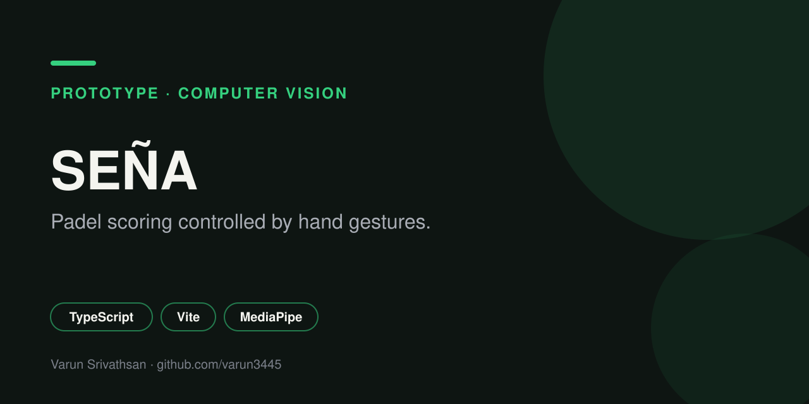

# Seña

A padel scoring app you control with your hand. Hold up a gesture and the point goes to the right team, so nobody has to touch a phone mid rally.

  

## How it works

The camera feed runs through the MediaPipe Hand Landmarker. Each frame is classified into one of four gestures. A gesture has to be held briefly and a short cooldown applies between actions, so stray movement does not score points. A hand holding a racquet is handled so a closed grip is not read as a fist.

| Gesture | Meaning |
| --- | --- |
| One finger | Point to team 1 |
| Two fingers | Point to team 2 |
| Open palm | Pause scoring |
| Fist | Resume scoring |

Point outcomes are announced aloud by speech synthesis.

## Scoring engine

Implements padel scoring end to end: points, games, sets, tiebreaks, singles and doubles, configurable sets to win, and a match history with results.

## Stack

TypeScript, Vite, MediaPipe Tasks Vision. No backend; match history is stored in the browser (`localStorage`).

## Status

Working gesture prototype.

## Author

[Varun Srivathsan](https://varunsrivathsan.com).
